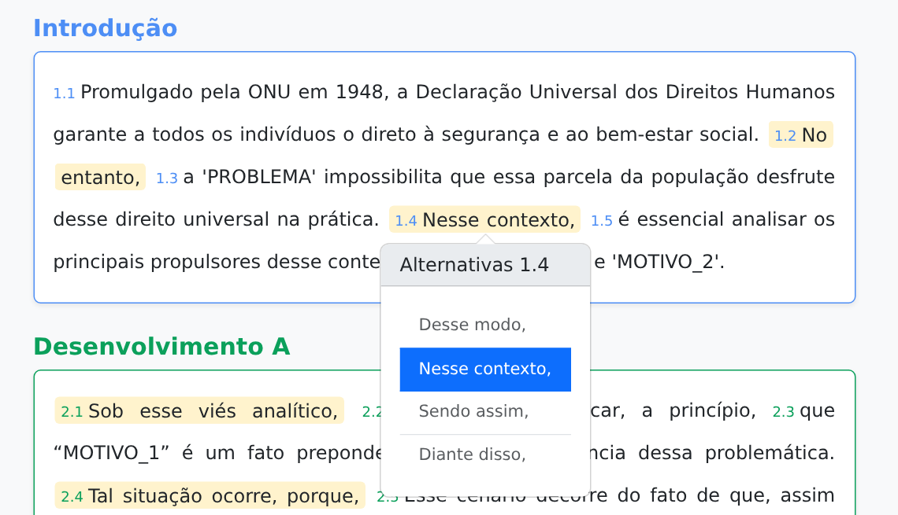

# Redação

Aplicação estática para explorar a estrutura de uma redação em quatro partes: introdução, dois parágrafos de desenvolvimento e conclusão. Cada parte é montada com trechos que podem ser trocados por alternativas do acervo local.

## Como abrir

Abra o arquivo [`index.html`](./index.html) diretamente no navegador. Não há instalação nem compilação.

O Bootstrap 5 é carregado por CDN; é necessária uma conexão com a internet para exibir seus estilos e usar os popovers de alternativas.

## Como usar

1. Ao abrir a página, uma alternativa é sorteada para cada trecho da redação.
2. Clique ou toque em qualquer trecho para ver outras opções. Pelo teclado, use Tab para chegar ao trecho e Enter ou Espaço para abrir as opções.
3. Escolha uma alternativa para mudar apenas esse trecho; os demais continuam como estão.

Exemplo do trecho 1.4 com as alternativas abertas:

As escolhas duram apenas enquanto a página está aberta. Ao atualizar a página, uma nova alternativa é sorteada para cada trecho. Marcadores como `PROBLEMA` e `MOTIVO_1` fazem parte dos modelos de texto e não são preenchidos automaticamente.

O rodapé reúne documentos oficiais sobre redação no ENEM e em concursos públicos, além de três referências bibliográficas.

## Arquivos principais

| Arquivo | Conteúdo |
| --- | --- |
| [`index.html`](./index.html) | Estrutura da página, referências e rodapé. |
| [`styles.css`](./styles.css) | Aparência dos parágrafos, trechos e rodapé. |
| [`script.js`](./script.js) | Sorteio, renderização e troca dos trechos. |
| [`data.js`](./data.js) | Textos disponíveis para cada posição da redação. |
| [`icon.svg`](./icon.svg) | Ícone da aplicação e favicon. |
| [`faculty-icon.png`](./faculty-icon.png) | Ícone da Faculdade de Farmácia no rodapé. |
